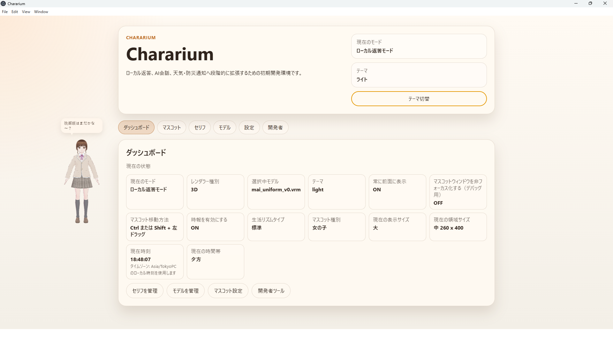
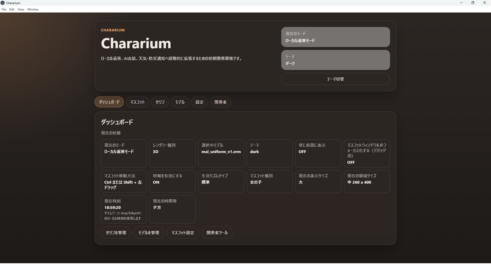
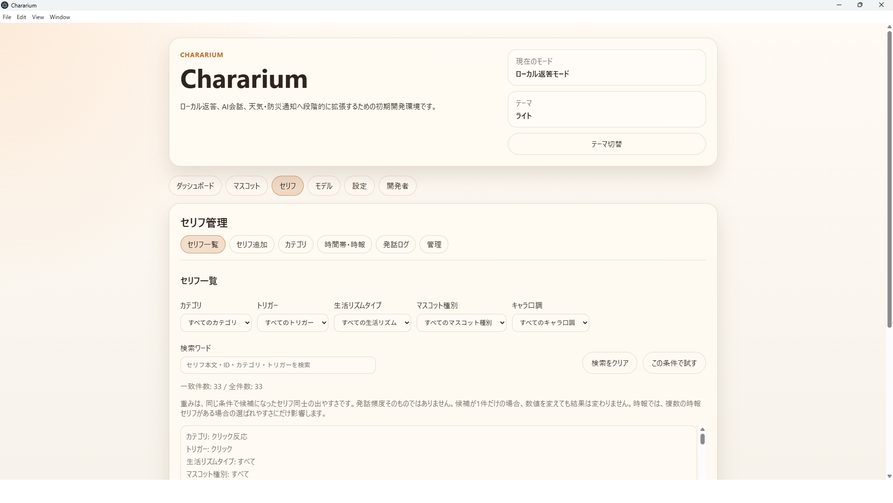
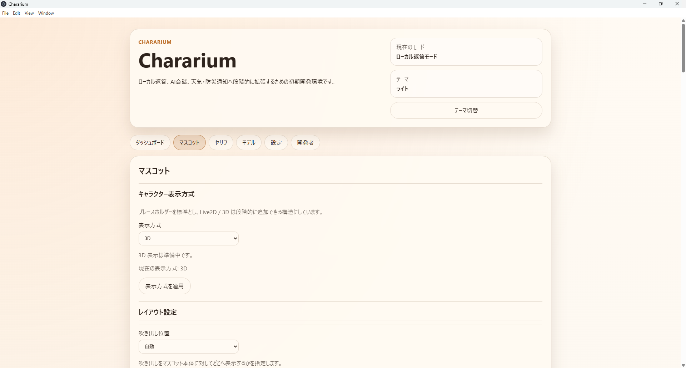

# Chararium

## 日本語

Chararium は、デスクトップ上に常駐するマスコットキャラクターアプリです。  
Electron + React + TypeScript をベースに、VRM / VRoid モデル表示、セリフ辞書、時報、自動つぶやき、キャラ口調切り替えなどを組み合わせて、作業中にちょっと話しかけてくれるデスクトップマスコットを目指しています。

## スクリーンショット

### ダッシュボードとマスコット





### セリフ管理



### マスコット設定



## 主な機能

- Electron + React + TypeScript によるデスクトップアプリ
- 透明マスコットウィンドウの表示
- VRM / VRoid モデルの表示
- セリフ辞書によるローカル返答
- セリフの追加・編集・検索・インポート・エクスポート
- キャラ口調の切り替え
  - 標準
  - 優しい妹系
  - 優しい兄弟系
  - アシスタント系
- 自動つぶやき機能
- 時報機能
- 発話ログ表示
- ライト / ダークテーマ切り替え
- ポータブル保存方式

## コンセプト

Chararium は、単なるチャットアプリではなく、PC作業中に画面の片隅で自然に反応してくれる「デスクトップ上の小さな同居キャラクター」を目指しています。

クリックした時の反応だけでなく、時間帯や生活リズムに合わせた声かけ、自動つぶやき、キャラクターごとの口調差分などを少しずつ拡張しています。

## 使用技術

- Electron
- React
- TypeScript
- Vite
- three.js
- @pixiv/three-vrm

## 起動方法

```powershell
cd E:\Dev\Chararium
npm install
npm run dev
```

## ビルド方法

```powershell
npm run typecheck
npm run build
```

## モデル素材について

VRM / Live2D などのモデルファイルは、ライセンス確認が必要なため、このリポジトリには標準では含めていません。

ローカルで使用する場合は、以下のような場所にモデルを配置します。

```txt
assets/models3d/your-model.vrm
```

## 開発状況

このプロジェクトは現在、個人開発中のプロトタイプです。

現在は、マスコット表示、VRMモデル表示、セリフ辞書、セリフ管理、自動つぶやき、キャラ口調切り替え、ポータブル保存などの基本機能を実装しています。

今後は、より自然なアニメーション制御、生活リズムに合わせた発話、ローカルLLM連携、天気や通知との連携などを検討しています。

---

## English

Chararium is a desktop mascot application that stays on your desktop.  
It is built with Electron, React, and TypeScript, and aims to provide a small companion character that can display VRM / VRoid models, speak through a local response dictionary, announce time-based messages, and react with different character voice profiles.

## Screenshots

### Dashboard and Mascot


### Response Manager


### Mascot Settings


## Features

- Desktop application built with Electron + React + TypeScript
- Transparent mascot window
- VRM / VRoid model display
- Local response dictionary
- Response add / edit / search / import / export
- Character voice profile switching
  - Standard
  - Gentle little-sister style
  - Gentle brother style
  - Assistant style
- Automatic idle speech
- Hourly chime / time-based speech
- Speech log viewer
- Light / dark theme switching
- Portable user data storage

## Concept

Chararium is not just a chat application.  
It aims to be a small desktop companion that naturally reacts while you are working on your PC.

The app is designed to support click reactions, time-based messages, automatic idle speech, and different speaking styles for each character profile.

## Tech Stack

- Electron
- React
- TypeScript
- Vite
- three.js
- @pixiv/three-vrm

## Getting Started

```powershell
cd E:\Dev\Chararium
npm install
npm run dev
```

## Build

```powershell
npm run typecheck
npm run build
```

## Model Assets

Model files such as VRM or Live2D assets are not included in this repository by default because each model may have its own license terms.

To use local model files, place them in a directory such as:

```txt
assets/models3d/your-model.vrm
```

## Development Status

This project is currently a personal prototype under active development.

The current implementation includes the mascot window, VRM model display, local response dictionary, response manager, automatic idle speech, character voice profiles, and portable user data storage.

Future ideas include more natural animation control, speech behavior based on the user's daily rhythm, local LLM integration, and weather or notification integrations.